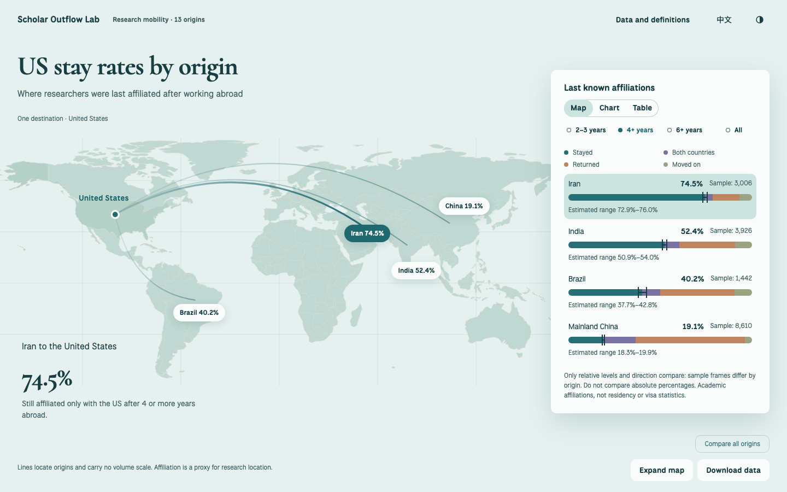
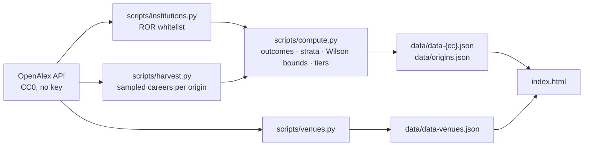

# Scholar Outflow Lab

**Where researchers from 13 countries ended up, and how much that depends on the country they came from.**

Pick an origin and a destination to see who stayed, who returned, who holds posts in both and who moved on,
stratified by how long they stayed. Thirteen origin countries, 1.43 million sampled authors, built entirely on free
public data ([OpenAlex](https://openalex.org), CC0) with a zero-dependency stack.

**Live:** https://nickkklian.github.io/Scholar-Outflow-Lab/ — English by default, 中文 toggle in the header.

Researchers who began publishing at home and then held a post in the United States for four or more years, by
origin, and the share who stayed:

| Origin | Stay rate | n |
|---|---|---|
| Iran | 74.5% | 3,006 |
| India | 52.4% | 3,926 |
| Brazil | 40.2% | 1,442 |
| Mainland China | 19.1% | 8,610 |

Same destination, same sampling, same computation: a three- to four-fold spread. Compare relative levels and
direction, not absolute percentages: each origin's sample frame differs (see [How it's computed](#how-its-computed)).



---

## What's on the site

The site opens on a map comparing four origins, read from the published JSON. Map, Chart and Table share the same
duration controls, and **Compare all origins** opens the full comparison. Below the map sit six research views, an
origin picker and the methodology, each with its own hash link.

The **Origin Compare** view puts the same destination side by side across origins; the table above is its United
States column for stays of four or more years. The direction holds across the shared destinations. Each origin's
sample is "people who once published under that country's affiliation", which is why only relative levels and
direction are comparable.

## How it's computed

| Term | Definition |
|---|---|
| **Sample** | Random sample of OpenAlex authors who ever published under an origin-country affiliation, with ≥5 works |
| **Home start** | The earliest career year includes the origin country |
| **Arrival** | A later foreign affiliation spanning ≥2 calendar years (a single year is treated as co-authorship, not a move) |
| **Observation window** | Only arrivals at least 5 years old count — otherwise "hasn't left yet" is misread as "stayed" |
| **Outcomes** | Four mutually exclusive classes on the final known affiliations: **Stayed** (destination only) · **Dual** (both) · **Returned** (origin only) · **Onward** (third country). They sum to 100% by construction |
| **Strata** | 2–3 years · ≥4 years (default) · ≥6 years · any |
| **Tiers** | Institutions ranked by the **Wilson 95% lower bound** of the default-stratum stay rate, cut into quartiles R1–R4 |
| **Whitelist** | 18,211 institutions with a ROR ID and adequate output, to filter the phantom affiliations OpenAlex parses out of free-text strings |

Two deliberate choices in the ranking: percentiles rather than absolute cutoffs (absolute values
drift with sampling; relative position within a batch is stable), and the confidence bound rather
than the raw rate (40% of 25 people versus 30% of 300 — ranking by the bound lets small-sample
flukes sink on their own, with no extra rules).

Two things the data showed along the way, and why the definitions look the way they do:

- **Many researchers hold posts in two countries at once.** A large share of Chinese researchers hold a foreign post
  *and* a home co-appointment at the same time, so "dual" is its own outcome rather than being counted as both
  stayed and returned.
- **Length of stay changes the answer.** The 2–3-year band is dominated by visiting scholars and joint-training
  students, who were always going home. National University of Singapore, Chinese origin: **2.1%** stayed after
  2–3 years (n=144), **10.7%** after ≥4 (n=289), **13.0%** after ≥6 (n=185). The default stratum is ≥4 years for
  that reason.

The full story of these corrections, and one hypothesis that did not survive, is in [DOCS.md](DOCS.md).

### Pipeline



`scripts/daily.sh` runs the rounds on a schedule within the free quota.

### Download the data

The published JSON is the dataset, derived from OpenAlex's CC0 records. Every file sits in `data/`:
`data-{cc}.json` (one per origin, e.g.
[data-cn.json](https://nickkklian.github.io/Scholar-Outflow-Lab/data/data-cn.json)),
[origins.json](https://nickkklian.github.io/Scholar-Outflow-Lab/data/origins.json) (the origins and their
sample sizes) and
[data-venues.json](https://nickkklian.github.io/Scholar-Outflow-Lab/data/data-venues.json) (the venue
board). The Methodology page on the site links all of them.

## Architecture

Zero cost, zero accounts, zero third-party packages.

| Layer | Choice | Why |
|---|---|---|
| Data | OpenAlex REST API, CC0 | Free, no key; 1,000 requests/day on the free tier |
| Processing | Python 3 standard library only | Nothing to install; the pipeline is the documentation |
| Front end | Static HTML, CSS and vanilla JS with local fonts | Mobile-first, dark-mode aware, bilingual, deploys straight to GitHub Pages |
| Hosting | GitHub Pages from `main` | The computed JSON sits in `data/` beside the page; no server |
| Automation | launchd + a shell script | Runs once a week within the quota; see [DOCS.md](DOCS.md#automation-and-what-it-learned-the-hard-way) |

```
index.html              front-end entry point (EN/中文 toggle; names are stored in English, 中文 maps them back)
atlas.css, map.js       map styling and local Natural Earth geometry
fonts/                  licensed, self-hosted Cormorant and National Park WOFF2
appearance.js           one header light/dark toggle
data/data-<cc>.json     computed metrics per origin country — what the page reads
data/data-venues.json   journal / conference board (13,086 venues, 26 fields)
data/origins.json       manifest of generated origins — drives the origin switcher
scripts/harvest.py      sample author careers from OpenAlex → data/careers_<cc>.jsonl (resumable)
scripts/institutions.py institution whitelist (ROR + output floor + generic-name blacklist)
scripts/compute.py      aggregate → data/data-<cc>.json; idempotent, never publishes a half-finished re-harvest
scripts/venues.py       venue board, ranked within field by h-index
scripts/traffic.py      weekly snapshot of GitHub traffic (the API only keeps 14 days)
scripts/daily.sh        the scheduled round, ordered by cost and unlock value
tools/check-css.mjs     finds classes the page renders with no rule, and rules nothing renders (run in CI)
```

The page sits in the repo root because GitHub Pages serves `main`'s root. `data/` holds the published
JSON, which is committed, and the intermediate JSONL (hundreds of MB), which is gitignored.

## Reproduce

```bash
export OPENALEX_MAILTO=you@example.com   # joins the OpenAlex polite pool; optional but faster
python3 scripts/institutions.py          # whitelist, once (~60 requests)
python3 scripts/harvest.py cn --seeds 24 # ~180k authors (~1,200 requests; resumable)
python3 scripts/compute.py cn            # offline
python3 -m http.server 8791              # http://localhost:8791
```

Swap `cn` for any ISO-3166 code (`in`, `ir`, `br`, …). **Mind the quota:** the free tier is 1,000
requests per day, and one origin at 24 seeds needs about 1,200 — split it across two days or use
`--seeds 12`. Hitting the limit exits cleanly with the reset time; re-running the same command
resumes from the last completed seed.

## Known limitations

- A proxy built from academic affiliation records — not visa or immigration statistics, and not
  immigration or legal advice. It does not answer "which country is easiest to immigrate to" or
  "what are a student's odds".
- "Stayed" means the last known affiliation is in that country, not an immigration status.
- The sample is people with authorship records in OpenAlex: anyone who left before ever publishing at home is not
  in the frame.
- Institutions are parsed by OpenAlex from affiliation strings; the ROR + output whitelist and a
  generic-name blacklist remove most mismatches, not all. Research institutes are noisier than
  universities, so the UI offers a "universities only" filter.
- Field labels are coarse: OpenAlex's own taxonomy files applied computer science under Engineering
  ([details](DOCS.md#and-one-hypothesis-that-did-not-survive)). Conference coverage in OpenAlex is thin.
- Absolute values drift with sampling choices; compare across institutions, countries and
  origins, not against external figures.

## Tests

```bash
python3 -m unittest discover -s tests -v
python3 tests/mutations.py
```

The first runs the renderer, pipeline and published-data tests; the second breaks one rule or one published
number at a time — 13 mutations — and each must turn its test red. What each layer checks is in
[DOCS.md](DOCS.md#tests).

## Data and license

Code: MIT. Data: [OpenAlex](https://openalex.org), CC0 public domain.
This project does not provide immigration, legal or financial advice.
